# Settings & Diagnostics Mobile-to-Web Parity Audit & Implementation Specifications

**Audit ID:** `ohm#w43s134b`  
**Date:** 2026-10-12  
**Auditor:** Antigravity (Read-Only Deep Audit Pass)  
**Target Codebases:**
- Mobile Source of Truth: `D:\Projects\OHMployee`
- Web Target: `D:\Projects\ohmployee-web`

---

## 1. Executive Summary

This audit delivers an in-depth architectural and functional inventory of **App Settings**, **Self-Service Profile Security**, **Session Governance (Idle Timeout)**, **Security Center & Active Device Sessions**, and **System Diagnostics & Governance Controls** in the mobile Flutter application ([`OHMployee`](file:///D:/Projects/OHMployee)), comparing them directly against the Next.js 15 App Router web implementation in [`ohmployee-web`](file:///D:/Projects/ohmployee-web).

### Current Status
- **Mobile (`OHMployee`):** A battle-tested multi-tier settings, profile, session, and diagnostics architecture:
  1. **Self-Service Profile Settings (`profile_settings_screen.dart`):** Circular avatar picker with offline-safe byte preview, ML Kit face detection guard (exactly 1 human face required), WebP compression (≤ 500 KB, 512×512 max), private Supabase storage bucket (`profile_photos`) with strictly bounded pathing (`{auth.uid()}/avatar.webp`), signed 1-hour preview URLs with timestamp cache-busting, mobile number updates (`09XXXXXXXXX`), password change modal with Supabase auth updates, and full database audit logging (`UPDATE_AVATAR`, `UPDATE_MOBILE`, `CHANGE_PASSWORD`).
  2. **App Settings (`app_settings_screen.dart`):** Theme toggle (Light / Dark segmented picker), biometrics toggle, policy-locked 30-minute inactivity session display, deep navigation to Security Center, notification preference toggles (Push, Vacancy Alerts, Approval Alerts, SLA Breach Alerts), accessibility controls (Text Size: Default/Large; Font Family: Inter, SF Pro, Helvetica Neue, Plus Jakarta Sans, Manrope, System Default; Reduce Motion toggle), and About app/version telemetry.
  3. **Security Center (`security_center_screen.dart`):** Dedicated device governance portal displaying the current device card (IP address, login timestamp, live last-seen tracker), other active sessions list with device-type iconography, individual session revocation (`revoke_session`), mass revocation (`revoke_other_sessions` / "Logout All Others"), and a vertical chronological security compliance timeline from `security_audit_logs`.
  4. **Session Governance (`idle_timer_service.dart`):** Fixed company-wide 30-minute inactivity policy. Triggers an inactivity warning at 25 minutes and an auto-logout at 30 minutes, measuring elapsed wall-clock time across background and foreground transitions.
  5. **System Diagnostics & Governance (`diagnostics_screen.dart`):** Super Admin diagnostic tool providing real-time probes for:
     - Supabase connectivity & roundtrip network latency (ms).
     - Administrative Governance RPC health (`fn_get_governance_controls`).
     - Operational Freeze mode status (`fn_get_freeze_modes` checking Payroll Freeze, Audit Freeze, Recruitment Freeze, and Read-Only Emergency Mode).
     - Security Audit Log query availability (`fn_get_governance_audit_log`).
     - PostgREST Schema Cache reminder and clipboard copy utility (`NOTIFY pgrst, 'reload schema';`).
- **Web (`ohmployee-web`):** Complete placeholder shell. Route [`src/app/(dashboard)/settings/page.tsx`](file:///d:/Projects/ohmployee-web/src/app/(dashboard)/settings/page.tsx) renders only `<ModuleEmptyState href="/settings" />` (6 lines of code). None of the profile, appearance, notification, session, security, or diagnostic features exist on web.

---

## 2. Feature & Sub-Section Inventory

### 2.1 Tab & Sub-Section Architecture Comparison

| Domain / Sub-Section | Mobile Implementation | Web Target (`ohmployee-web`) | Parity Status |
| :--- | :--- | :--- | :--- |
| **Profile Settings** | [`profile_settings_screen.dart`](file:///D:/Projects/OHMployee/lib/features/profile/profile_settings_screen.dart) & [`profile_service.dart`](file:///D:/Projects/OHMployee/lib/data/services/profile_service.dart) | None | ❌ **Missing on Web** |
| **App Settings & Preferences** | [`app_settings_screen.dart`](file:///D:/Projects/OHMployee/lib/features/settings/app_settings_screen.dart) & [`app_preferences_service.dart`](file:///D:/Projects/OHMployee/lib/data/services/app_preferences_service.dart) | None | ❌ **Missing on Web** |
| **Security Center (Active Sessions)** | [`security_center_screen.dart`](file:///D:/Projects/OHMployee/lib/features/settings/security_center_screen.dart) & [`security_session_service.dart`](file:///D:/Projects/OHMployee/lib/data/services/security_session_service.dart) | None | ❌ **Missing on Web** |
| **Session Governance (Idle Timeout)** | [`idle_timer_service.dart`](file:///D:/Projects/OHMployee/lib/core/session/idle_timer_service.dart) | None | ❌ **Missing on Web** |
| **Security Dashboard (Super Admin)** | [`security_dashboard_screen.dart`](file:///D:/Projects/OHMployee/lib/features/security/security_dashboard_screen.dart) | None | ❌ **Missing on Web** |
| **System Diagnostics (Super Admin)** | [`diagnostics_screen.dart`](file:///D:/Projects/OHMployee/lib/features/safespace/diagnostics_screen.dart) & [`system_governance_service.dart`](file:///D:/Projects/OHMployee/lib/data/services/system_governance_service.dart) | None | ❌ **Missing on Web** |

---

### 2.2 Deep Feature Breakdown

#### Tab 1: Profile Information & Security
- **Avatar Management:**
  - Avatar preview (circular, 108×108) with pending in-memory preview, signed URL from Supabase storage, or initials fallback.
  - Upload avatar: Client-side file selection (drag & drop / file picker on web), WebP conversion / client-side compression (≤ 500 KB limit), upload binary to bucket `profile_photos` strictly at `{auth.uid()}/avatar.webp`.
  - RPC synchronization: Call `update_own_profile(p_mobile_number, p_avatar_path)`.
  - Auth metadata & Cache busting: Updates `auth.users.raw_user_meta_data->avatar_url` with cache-buster `?v={timestamp}`.
  - Delete avatar: Removes binary from storage, sets `avatar_path = NULL` via RPC, and clears `avatar_url` in auth metadata.
- **Account Information (Read-Only Card):**
  - Full Name: Displayed from `users_profile.full_name`.
  - Email Address: Displayed from `users_profile.email`.
  - Assigned Role: Displayed from `roles.role_name`.
- **Contact Details (Editable):**
  - Mobile Number: Input field strictly validating `^09[0-9]{9}$` (11 digits, Philippine telecom standard).
  - Save Changes button: Disables when idle or offline; submits changes via `update_own_profile`.
- **Password Management:**
  - "Change Password" modal dialog.
  - Fields: `New Password`, `Confirm Password` (with reveal/hide toggles).
  - Validation: Minimum 8 characters, fields match.
  - Execution: Calls `supabase.auth.updateUser({ password })`.
  - Auditing: Database trigger `trg_on_auth_user_password_changed` on `auth.users` logs `CHANGE_PASSWORD` into `public.audit_logs`.

#### Tab 2: Appearance & Preferences (App Settings)
- **Appearance:**
  - Theme Selector: Segmented controls for `Light`, `Dark`, and `System Default`.
  - Web behavior: Integrated with Next-themes / Tailwind dark mode class and synchronized with `user_settings.theme_mode`.
- **Typography & Accessibility:**
  - Text Size: `Default` vs. `Large` dropdown.
  - Font Family: Select dropdown (`Inter`, `SF Pro`, `Helvetica Neue`, `Plus Jakarta Sans`, `Manrope`, `System Default`).
  - Reduce Motion: Boolean toggle controlling transitions and smooth scroll behaviors.
- **Notification Preferences:**
  - Push Notifications: Master toggle (controls `user_settings.push_notifications_enabled`).
  - Vacancy Alerts: Toggle (`user_settings.vacancy_alerts_enabled`).
  - Approval Alerts: Toggle (`user_settings.approval_alerts_enabled`).
  - SLA Breach Alerts: Toggle (`user_settings.sla_breach_alerts_enabled`).
- **About & Version Telemetry:**
  - App Name: `OHMployee Web`.
  - Version & Build: Environment constants (e.g., `v1.0.0-web`, commit SHA).

#### Tab 3: Session Governance & Security Center
- **Idle Timeout Policy (Read-Only Display):**
  - Company-wide fixed 30-minute inactivity policy notice.
  - Explains warning dialog fires at 25 minutes and auto-logout occurs at 30 minutes.
- **Session Heartbeat & Tracking:**
  - Background periodic heartbeat every 5 minutes and on window focus/tab activity.
  - Calls RPC `heartbeat_session(p_session_id, p_device_platform, p_app_version, p_ip_address)`.
  - Stored in browser `localStorage` under `ohmployee.security.currentSessionId`.
  - Handles `SESSION_REVOKED` error by immediately forcing signout and redirecting to login.
- **Current Device Card:**
  - Identifies current device session via cached session ID.
  - Displays: Platform name (`Web Browser - Chrome/Firefox/Safari`), IP address, login timestamp, and live relative last active indicator (`Active just now`).
- **Other Active Sessions List:**
  - Fetches from `active_user_sessions` where `revoked_at IS NULL` and `id != currentSessionId`.
  - Displays platform icon, device name, IP address, and last active time.
  - Revoke Individual Session: Destructive action calling `revoke_session(sessionId)` with confirmation modal.
  - Logout All Others: Prompts confirmation modal; executes `revoke_other_sessions(currentSessionId)`.
- **Security Compliance History:**
  - Chronological vertical timeline of recent security events from `security_audit_logs`.
  - Action types: `LOGIN`, `LOGOUT`, `REMOTE_REVOKE`, `REVOKE`, `SECURITY_SETTINGS_CHANGED`, `SUSPICIOUS_LOGIN`.
  - Displays event badge, humanized message, IP address, device platform, and relative timestamp.

#### Tab 4: System Diagnostics & Health (Super Admin Only)
- **Role Guard:** Strictly restricted to users with `isSuperAdmin` (role level 100).
- **Probes & Visual Indicators:**
  1. **Supabase Connectivity & Latency:**
     - Ping probe executing a lightweight query (e.g. `fn_check_governance_control('account_registration')`).
     - Reports connection status (`CONNECTED` / `FAILED`) and latency in milliseconds with color grading (<200ms green, <500ms orange, ≥500ms red).
  2. **Governance RPC Health:**
     - Invokes `fn_get_governance_controls`.
     - Confirms RPC execution, returns active control count, or surfaces PostgREST schema/permission errors.
  3. **Operational Freeze Status:**
     - Invokes `fn_get_freeze_modes`.
     - Inspects all emergency freeze switches: `Payroll Freeze`, `Audit Freeze`, `Recruitment Freeze`, and `Read-Only Emergency Mode`.
     - Displays badge `NO ACTIVE FREEZES` (green) or `ACTIVE FREEZES` (red) with per-freeze breakdowns.
  4. **Security Audit Log Availability:**
     - Invokes `fn_get_governance_audit_log` with limit probe.
     - Confirms read availability and surfaces recent event counts.
  5. **Schema Cache Reminder:**
     - PostgREST PGRST202 schema refresh explanation.
     - One-click copyable SQL command box: `NOTIFY pgrst, 'reload schema';`.

---

## 3. Schema & Database RPC Mapping

### 3.1 Tables & Schema Structure

| Table Name | Key Columns | Purpose & Constraints |
| :--- | :--- | :--- |
| `public.users_profile` | `id`, `auth_user_id`, `full_name`, `email`, `role_id`, `mobile_number`, `avatar_path`, `is_active` | Core profile table. `mobile_number` constrained by `chk_mobile_number CHECK (mobile_number IS NULL OR mobile_number ~ '^09[0-9]{9}$')`. |
| `public.user_settings` | `user_id` (PK), `push_notifications_enabled`, `vacancy_alerts_enabled`, `approval_alerts_enabled`, `sla_breach_alerts_enabled`, `reduce_motion_enabled`, `text_size`, `theme_mode`, `auto_logout_minutes`, `biometric_enabled`, `font_family`, `updated_at` | Stores customizable user preferences. Protected by RLS for user self-read/update. |
| `public.active_user_sessions` | `id` (PK, uuid), `user_id`, `device_platform`, `app_version`, `ip_address`, `login_at`, `last_seen_at`, `revoked_at`, `revoke_reason`, `is_suspicious` | Active device & browser session tracking. Indexed on `user_id` and active filter `revoked_at IS NULL`. |
| `public.security_audit_logs` | `id` (PK, uuid), `user_id`, `session_id`, `action`, `ip_address`, `device_platform`, `details` (jsonb), `created_at` | Audit trail for security events: `LOGIN`, `LOGOUT`, `REMOTE_REVOKE`, `REVOKE`, `SECURITY_SETTINGS_CHANGED`, `SUSPICIOUS_LOGIN`. |
| `public.governance_controls` | `id` (PK, uuid), `control_key` (UNIQUE), `enabled`, `updated_by`, `updated_at`, `reason` | Holds operational controls and freeze flags. Only Super Admin can read/update. |
| `public.governance_audit_log` | `id` (PK, uuid), `control_key`, `action`, `before_value`, `after_value`, `changed_by`, `changed_at`, `reason`, `metadata` | Audit trail of governance toggles. |
| `storage.buckets` (`profile_photos`) | `id = 'profile_photos'`, `public = FALSE`, `file_size_limit = 512000`, `allowed_mime_types = ARRAY['image/webp']` | Private bucket with strict RLS: authenticated SELECT for all users, ALL (write/delete) strictly matching `name = (auth.uid()::text || '/avatar.webp')`. |

### 3.2 RPC Functions & API Endpoints

```mermaid
flowchart TD
    subgraph Client ["ohmployee-web Client"]
        P[Profile Tab]
        S[Preferences Tab]
        SC[Security Center Tab]
        D[Diagnostics Tab]
        Idle[Idle Activity Listener]
    end

    subgraph Supabase ["Supabase Backend"]
        RPC_Profile["update_own_profile(p_mobile, p_avatar)"]
        RPC_Heartbeat["heartbeat_session(...)"]
        RPC_Revoke["revoke_session(p_session_id)"]
        RPC_RevokeOther["revoke_other_sessions(p_current_session_id)"]
        RPC_Gov["fn_get_governance_controls()"]
        RPC_Freeze["fn_get_freeze_modes()"]
        RPC_Audit["fn_get_governance_audit_log()"]
        Table_Settings["public.user_settings"]
        Storage_Bucket["storage.buckets / profile_photos"]
        Auth_Users["supabase.auth.updateUser()"]
    end

    P -->|Upload WebP| Storage_Bucket
    P -->|Update metadata| RPC_Profile
    P -->|Change Password| Auth_Users
    S -->|Save preferences| Table_Settings
    Idle -->|Every 5m / on focus| RPC_Heartbeat
    SC -->|Revoke single| RPC_Revoke
    SC -->|Revoke others| RPC_RevokeOther
    D -->|Probe controls| RPC_Gov
    D -->|Probe locks| RPC_Freeze
    D -->|Probe logs| RPC_Audit
```

| RPC / Function Name | Security Type | Input Parameters | Return Value | Purpose & Logic |
| :--- | :--- | :--- | :--- | :--- |
| `public.update_own_profile` | `SECURITY DEFINER` | `p_mobile_number TEXT`, `p_avatar_path TEXT` | `void` | Updates caller's mobile number and avatar path in `users_profile`. Validates format `^09[0-9]{9}$` and ensures avatar path strictly equals `{auth.uid()}/avatar.webp`. Automatically records audit logs. |
| `public.heartbeat_session` | `SECURITY DEFINER` | `p_session_id UUID`, `p_device_platform TEXT`, `p_app_version TEXT`, `p_ip_address TEXT` | `UUID` | Registers or refreshes session timestamp. Checks if revoked; throws `SESSION_REVOKED` if terminated. Sets `is_suspicious` if concurrent disparate devices exist. |
| `public.revoke_session` | `SECURITY DEFINER` | `p_session_id UUID` | `void` | Marks session `revoked_at = NOW()`, `revoke_reason = 'user_logout' \| 'admin_revoke'`. Restricts execution to owner or Super Admin. |
| `public.revoke_other_sessions` | `SECURITY DEFINER` | `p_current_session_id UUID` | `void` | Revokes all active sessions for current user except the provided current session ID. |
| `public.fn_get_governance_controls` | `SECURITY DEFINER` | None | Table `(control_key, enabled, updated_at, reason, updated_by_name)` | Returns all system governance controls. |
| `public.fn_get_freeze_modes` | `SECURITY DEFINER` | None | Table of governance freeze controls | Returns active freeze modes (`payroll_freeze`, `audit_freeze`, `recruitment_freeze`, `read_only_emergency`). |
| `public.fn_get_governance_audit_log` | `SECURITY DEFINER` | None | Table of governance audit records | Queries recent governance changes. Super Admin only. |
| `public.fn_check_governance_control` | `SECURITY DEFINER` | `p_control_key TEXT` | `boolean` | Checks if a given control is enabled. Used for lightweight latency ping probe. |

---

## 4. Web vs Mobile Architecture & Behavioral Differences

### 4.1 Client Environment Differences

1. **Biometric Authentication:**
   - *Mobile:* Uses `local_auth` / `biometric_auth_service.dart` for device Face ID / Fingerprint prompt.
   - *Web Adaptation:* Native mobile biometrics cannot run in standard desktop web browsers without WebAuthn / Passkeys. For Web Phase 1, omit device biometrics or present WebAuthn/Passkey registration as a future enhancement, displaying "Device Biometrics: Mobile Only" if desired, or omitting from web settings.
2. **Face Detection Gate:**
   - *Mobile:* Uses Google ML Kit (`google_mlkit_face_detection`) to reject images lacking exactly 1 human face.
   - *Web Adaptation:* Web cannot invoke native mobile ML Kit libraries directly. On web, profile photo uploads should validate client-side image MIME types (WebP/JPEG/PNG), dimensions (min 128x128, max 4096x4096px), file size (under 5 MB prior to canvas/worker compression to WebP ≤ 500 KB), and crop/aspect ratio (1:1 circular crop modal).
3. **Session Idle Detection:**
   - *Mobile:* Uses `WidgetsBindingObserver` to track app pause/resume and UI interaction events.
   - *Web Adaptation:* Implement a global DOM event listener hook (`useIdleTimer`) listening to `mousemove`, `keydown`, `wheel`, `touchstart`, and `visibilitychange`. If idle for 25 minutes, render an `<IdleWarningModal />` countdown; if idle for 30 minutes, invoke signout and clear session.

---

## 5. Parity Gap Analysis

### 5.1 Critical Gaps Identified on Web
1. **Empty Route:** `src/app/(dashboard)/settings/page.tsx` is completely empty. Users navigating to Settings see an empty placeholder.
2. **No Profile Editing:** Users cannot update their profile picture or mobile number on web.
3. **No Password Update Flow:** Users cannot change their password from within the dashboard.
4. **No Session Monitoring or Termination:** Users have no visibility into active web/mobile sessions and cannot remotely revoke suspicious or stale logins.
5. **No Idle Timeout Enforcement:** Web sessions can remain open indefinitely on shared workstations, posing security and compliance risks.
6. **No Super Admin System Diagnostics:** Super Admins cannot verify database latency, PostgREST schema cache states, or system freeze locks from the web interface.

---

## 6. Implementation Roadmap

### Phase 1: Core Foundation & Tabbed Shell
- **Create Settings Layout & Navigation:**
  - Build `src/app/(dashboard)/settings/page.tsx` as a multi-tab dashboard layout:
    - Tab 1: **Profile & Security** (Personal information, avatar, mobile, password)
    - Tab 2: **Preferences & Appearance** (Theme mode, text size, font, notifications)
    - Tab 3: **Active Sessions & Security Center** (Current session, remote logout, compliance timeline)
    - Tab 4: **System Diagnostics** (Super Admin only: Latency, RPC health, freeze locks, schema cache)
- **Implement Shared Types & Queries:**
  - `src/lib/types/settings.ts`: Types for `ProfileData`, `UserSettings`, `ActiveUserSession`, `SecurityAuditLog`, `GovernanceControl`.
  - `src/lib/queries/settings.ts`: React Query hooks for fetching profile, user settings, active sessions, and security logs.

### Phase 2: Profile & Security Tab
- **Avatar Uploader & Cropper Component (`src/components/settings/AvatarUploader.tsx`):**
  - File picker & drag-and-drop supporting PNG, JPEG, WebP.
  - Client-side canvas compression to WebP (512x512, ≤ 500 KB).
  - Storage upload to `profile_photos` bucket (`{auth.uid()}/avatar.webp`).
  - Calls `update_own_profile` RPC and updates user metadata.
  - Delete avatar functionality with confirmation dialog.
- **Account Info & Mobile Number Editor (`src/components/settings/ProfileInfoCard.tsx`):**
  - Read-only fields: Full Name, Email, Role.
  - Editable field: Mobile Number with validation (`^09[0-9]{9}$`).
- **Change Password Dialog (`src/components/settings/ChangePasswordModal.tsx`):**
  - New password & confirm password validation.
  - Submits via `supabase.auth.updateUser({ password })`.

### Phase 3: Preferences & Appearance Tab
- **Appearance & Typography Controls (`src/components/settings/PreferencesCard.tsx`):**
  - Theme mode selector (Light, Dark, System) connected to `next-themes` and `user_settings.theme_mode`.
  - Font family and text size selection.
  - Reduce motion toggle.
  - Notification alert switches (Push, Vacancy Alerts, Approval Alerts, SLA Breach Alerts).
  - Persists changes to `public.user_settings` table.

### Phase 4: Session Governance & Security Center Tab
- **Client Idle Timer Hook (`src/hooks/useIdleTimer.ts`):**
  - Attaches listeners to user activity events.
  - Warning modal at 25 minutes; auto logout at 30 minutes.
- **Heartbeat Daemon (`src/components/settings/SessionHeartbeatProvider.tsx`):**
  - Executes `heartbeat_session` RPC on mount, every 5 minutes, and on tab visibility resume.
  - Catches `SESSION_REVOKED` and triggers automatic signout.
- **Security Center UI (`src/components/settings/SecurityCenterCard.tsx`):**
  - Current device card with platform detection, IP address, and last seen timer.
  - Active sessions table with individual "Revoke" button.
  - "Logout All Others" button with destructive confirmation modal.
  - Chronological vertical timeline of `security_audit_logs`.

### Phase 5: Super Admin System Diagnostics Tab
- **Diagnostics Panel (`src/components/settings/DiagnosticsCard.tsx`):**
  - Gated by `isSuperAdmin`.
  - Probe 1: Supabase Connectivity & Latency measurement.
  - Probe 2: Governance RPC probe (`fn_get_governance_controls`).
  - Probe 3: Operational Freeze mode status (`fn_get_freeze_modes`).
  - Probe 4: Security Audit Log query availability (`fn_get_governance_audit_log`).
  - Probe 5: PostgREST Schema Cache reminder with copyable command (`NOTIFY pgrst, 'reload schema';`).
- **Verification & Parity Audit Sign-Off:**
  - End-to-end verification of all tabs in desktop and mobile viewports.

---

## 7. Verification Checklist

- [x] Full mobile codebase audited for settings, profile, session, diagnostics, and security features.
- [x] Schema constraints, table definitions, and RPC functions cataloged and cross-referenced.
- [x] Parity gaps thoroughly analyzed and mapped to web components.
- [x] Phased implementation roadmap formulated.
- [x] Audit report generated and committed to `docs/audit/settings_diagnostics_mobile_web_parity_audit.md`.
